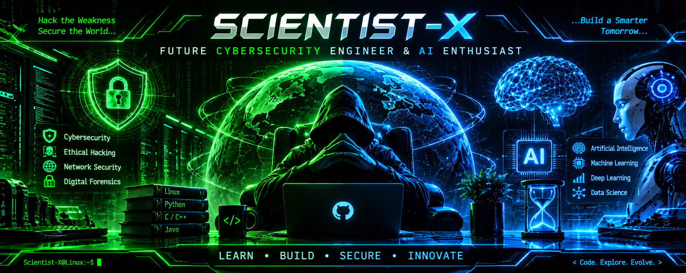

 

# THE SCIENTIST

### Future Cybersecurity Engineer | BS Computer Science | AI Enthusiast

---

## 👨‍💻 About Me

Hello! I'm **The Scientist**, a BS Computer Science student interested in Cybersecurity, Artificial Intelligence, and Software Engineering.

I enjoy learning how technology works, solving problems, experimenting with Linux, and building practical software projects.

## ⚡ Technologies & Tools

**Programming Languages**

**Tools**

## 🎯 Areas of Interest

- Cybersecurity & Ethical Hacking
- Artificial Intelligence & Machine Learning
- Linux & Command Line
- Software Development
- Problem Solving

## 📚 Currently Learning

- Java and Object-Oriented Programming
- Python programming
- Linux fundamentals
- Cybersecurity fundamentals
- Artificial Intelligence fundamentals

## 🚀 Featured Projects

*My selected projects will appear here as I build and publish them.*

<!-- Add real project links here.

### Project Name
Brief explanation of what the project does.

Technologies: Python / Java / C++

[View Project](YOUR_REPOSITORY_LINK)

-->

## 📊 GitHub Statistics

## 🌐 Connect With Me

---

### LEARN • BUILD • SECURE • INNOVATE

**< Code. Explore. Evolve. />**

